# Festbüro

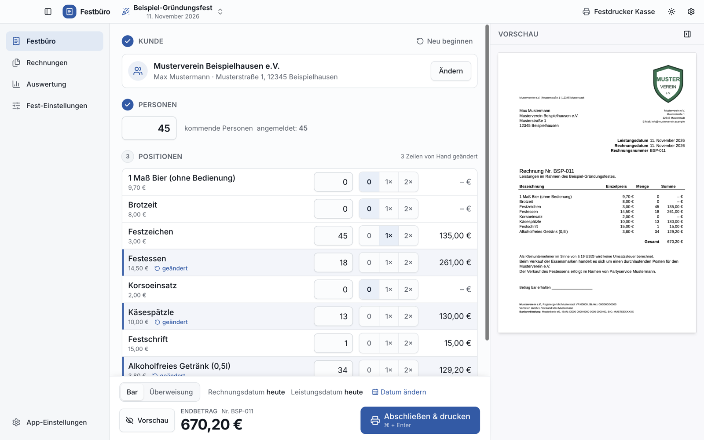

Mit Festbüro erstellt das Festbüro eines Gründungsfests Rechnungen an Vereine und Einzelpersonen in wenigen
Sekunden. Jede Rechnung wird als PDF abgelegt und **ohne Druckdialog** sofort gedruckt. Das Programm läuft
auf macOS und Windows, komplett offline – ohne Internet, Cloud oder Anmeldung.

**Inhalt:** [1. Installation](#1-installation) · [2. Einrichtung](#2-einrichtung) ·
[3. Benutzung am Festtag](#3-benutzung-am-festtag) · [4. Nach dem Fest](#4-nach-dem-fest) ·
[5. Datensicherung](#5-datensicherung) · [Häufige Fragen](#häufige-fragen)

> Alle Namen, Adressen und Vereine in den Bildern (Musterverein e.V., Beispiel-Fest) sind erfunden.

## 1. Installation

### Herunterladen

Auf der **[Download-Seite](https://github.com/mgmeinwi/festbuero-app/releases/latest)** unten bei
„Assets“ die passende Datei anklicken:

| Computer | Datei |
| --- | --- |
| Mac (macOS 12 oder neuer, Apple-Chip und Intel) | `Festbuero-…-mac-universal.dmg` |
| Windows 10 oder 11 (64-Bit) | `Festbuero-…-win-x64-setup.exe` |

Das Programm ist (noch) nicht von Apple bzw. Microsoft signiert. Deshalb warnt der Computer beim ersten Start,
dass der Entwickler nicht bekannt ist. Das ist normal – die Schritte unten zeigen, wie man das Programm
trotzdem öffnet. Es ist nur einmal nötig.

### Mac

1. Die heruntergeladene `.dmg`-Datei doppelklicken. Es öffnet sich ein Fenster.
2. Das Symbol **Festbuero** auf den Ordner **Programme** ziehen. Danach das Fenster schließen.
3. Den Ordner **Programme** im Finder öffnen und **Festbuero** doppelklicken.
   macOS meldet: *„Festbuero“ kann nicht geöffnet werden …* – auf **Fertig** bzw. **OK** klicken.
4. Öffnen erlauben:
   - **macOS 15 (Sequoia) oder neuer:**  → **Systemeinstellungen** → **Datenschutz & Sicherheit**,
     ganz nach unten scrollen. Bei *„Festbuero“ wurde blockiert …* auf **Dennoch öffnen** klicken und mit
     Passwort oder Touch ID bestätigen.
   - **macOS 14 oder älter:** Im Ordner Programme mit **Rechtsklick** (oder Ctrl-Klick) auf **Festbuero**
     → **Öffnen** und im Dialog nochmals **Öffnen** wählen.
5. Festbüro startet. Ab jetzt öffnet es sich ganz normal per Doppelklick, über das Launchpad oder das Dock.

<details>
<summary>macOS meldet, die App sei „beschädigt“?</summary>

Dann hat macOS beim Herunterladen eine Sperre gesetzt. Das Programm **Terminal** öffnen (Programme →
Dienstprogramme), folgende Zeile einfügen, Enter drücken und Festbüro erneut starten:

```bash
xattr -dr com.apple.quarantine /Applications/Festbuero.app
```

</details>

### Windows

1. Die heruntergeladene Datei `Festbuero-…-win-x64-setup.exe` doppelklicken.
2. Erscheint **„Der Computer wurde durch Windows geschützt“**: auf **Weitere Informationen** klicken,
   dann auf **Trotzdem ausführen**.
3. Dem Installationsassistenten folgen. Die Vorgaben passen in der Regel (Installation nur für den aktuellen
   Benutzer, keine Administratorrechte nötig).
4. Festbüro über die Verknüpfung **Festbüro** auf dem Desktop oder im Startmenü starten.

### Updates

Festbüro sucht beim Start automatisch nach einer neuen Version, sofern der Rechner online ist. Gibt es
eine, erscheint unten rechts ein Hinweis. Von Hand geht es über **App-Einstellungen → Updates → Nach
Updates suchen** oder das Menü **Hilfe → Nach Updates suchen …**. Installiert wird nie ohne Rückfrage.

- **Windows:** **Herunterladen**, dann **Jetzt neu starten**. Festbüro installiert das Update und startet
  von selbst neu. Wer nicht neu startet, bekommt das Update beim nächsten Beenden.
- **Mac:** **Herunterladen**, dann **Beenden und installieren**. Festbüro schließt sich und öffnet das
  Installationsfenster. Dort **Festbuero** auf **Programme** ziehen, **Ersetzen** wählen und Festbüro wieder
  starten.

Rechnungen, Vereine und Einstellungen bleiben bei jedem Update erhalten. Vor einem Update während der
Festtage trotzdem kurz eine [Datensicherung](#5-datensicherung) erstellen. Die automatische Suche lässt sich
unter App-Einstellungen → Updates abschalten.

> Version 1.0.0 kennt die Update-Funktion noch nicht. Wer sie installiert hat, installiert die nächste
> Version einmalig von Hand wie oben beschrieben (Daten bleiben erhalten); danach geht es automatisch.

## 2. Einrichtung

### Einrichtungsassistent

Beim ersten Start führt ein Assistent in wenigen Schritten durch die Einrichtung:

1. **Dokumentenordner** wählen – dort legt Festbüro alle Rechnungs-PDFs und Datensicherungen ab
   (Vorschlag: `Dokumente/Festbüro`).
2. **Festdrucker** wählen – auf diesem Drucker wird ohne Rückfrage gedruckt.
3. **Erstes Gründungsfest** anlegen (Name, Festdatum, Rechnungsnummern).
   Wer das Programm erst einmal ausprobieren möchte, wählt stattdessen das **Beispiel-Fest** mit erfundenen
   Vereinen und fertigen Produkten.
4. **Fertig** – auf Wunsch gleich eine Testseite drucken.

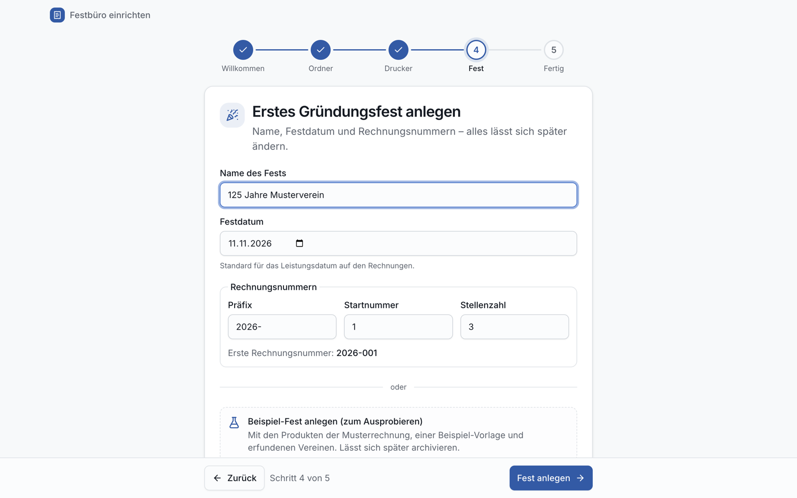

Der Assistent lässt sich später unter **App-Einstellungen → Einrichtung** oder im Menü **Hilfe** erneut öffnen.

### Das Fest einrichten

Danach in der linken Leiste **Fest-Einstellungen** öffnen und die Reiter von links nach rechts durchgehen:

| Reiter | Was man dort einstellt |
| --- | --- |
| **Allgemein** | Name und Datum des Fests, Steuer (7 %/19 % MwSt oder steuerbefreit nach § 19 UStG). |
| **Nummern** | Wie die Rechnungsnummern aussehen (Präfix, Startnummer, Stellen). Die Nummern laufen lückenlos; nach der ersten Rechnung ist die Startnummer gesperrt. |
| **Produkte** | Was abgerechnet wird, mit Bruttopreis und MwSt-Satz. Pro Produkt festlegen, ob die Menge **pro Person** oder als **feste Anzahl** vorbelegt wird. Die Reihenfolge gilt auch auf der Rechnung. |
| **Zahlarten** | Bar und Überweisung mit eigenem Zahlungstext und Zahlungsfrist. Platzhalter wie {Gesamtbetrag} oder {Fälligkeitsdatum} werden automatisch ersetzt. |
| **Vereine** | Die angemeldeten Vereine, einzeln anlegen oder aus einer Excel-Liste importieren (siehe unten). |
| **Vorlage** | Aussehen der Rechnung: Logo, Absender, Bankverbindung, Hinweistexte und Fußzeile. Die Vorschau rechts zeigt jede Änderung sofort. |

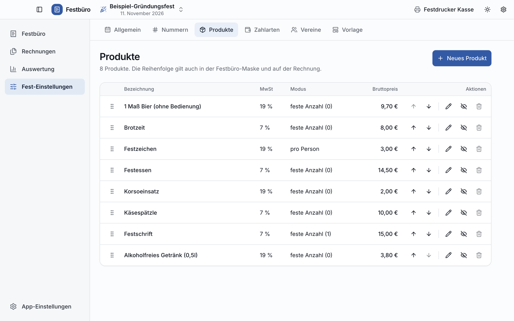

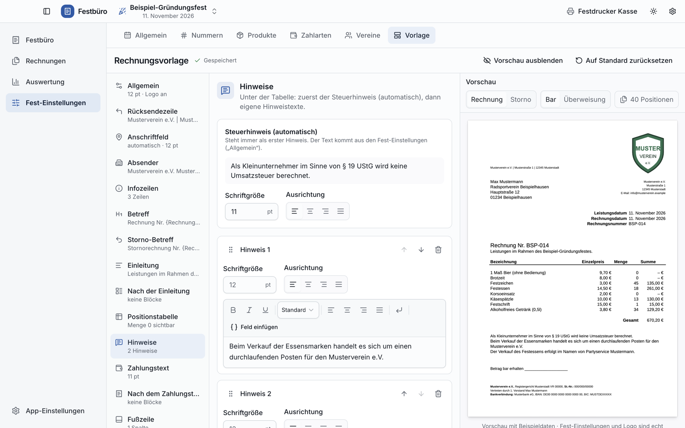

### Vereine aus Excel übernehmen

1. Unter **Fest-Einstellungen → Vereine** auf **Anmelde-Vorlage exportieren** klicken. Es entsteht eine
   Excel-Datei mit den passenden Spalten, die man z. B. an die Vereine oder den Vorstand weitergeben kann.
2. Die ausgefüllte Liste über **Aus Excel importieren** (oder ⌘/Strg + I) einlesen. Auch eigene Listen funktionieren,
   solange die Spaltenüberschriften ähnlich heißen.
3. Eine Vorschau zeigt, welche Zeilen übernommen werden und welche Zeilen warum übersprungen werden.

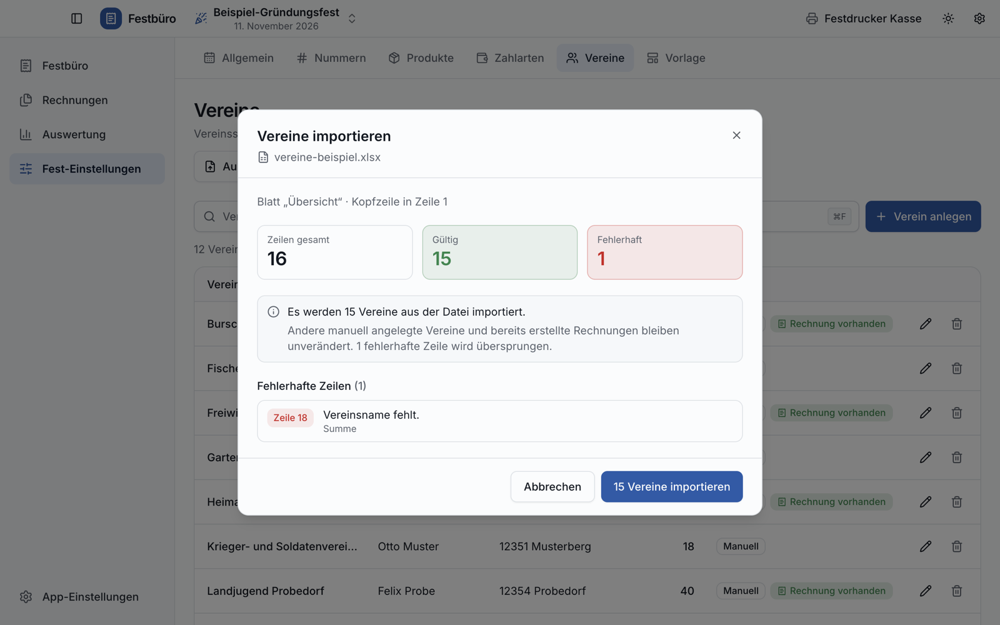

### Vor dem Fest: Druck testen

> **Wichtig:** Vor dem Fest auf **jedem Rechner**, der im Festbüro eingesetzt wird, eine Testseite drucken:
> **App-Einstellungen → Drucker → Testseite drucken.** Die Testseite ist eine Musterrechnung mit eurer
> Vorlage (Nummer „MUSTER“) und wird nicht als Rechnung gespeichert. Prüfen, dass sie ohne Dialog,
> vollständig und in der richtigen Größe aus dem Drucker kommt.

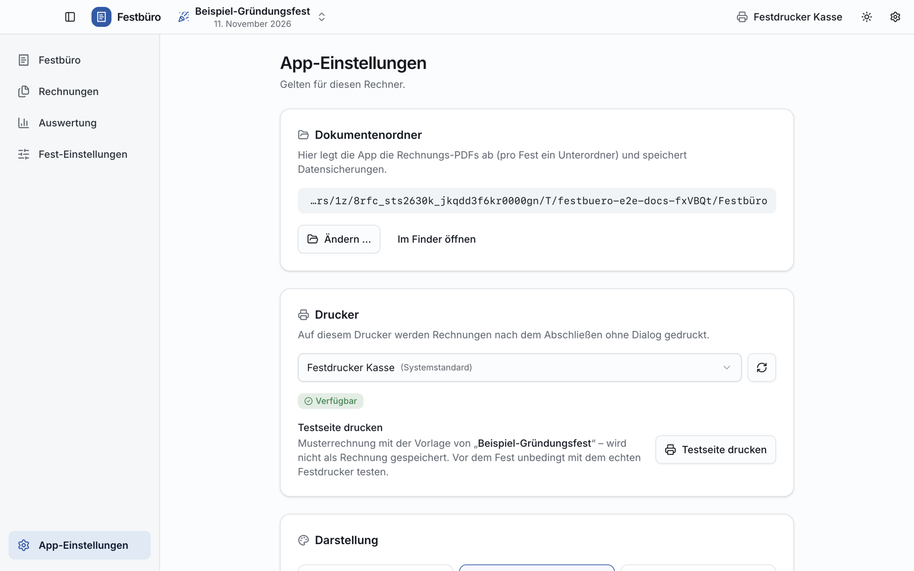

## 3. Benutzung am Festtag

### Eine Rechnung erstellen

Die Seite **Festbüro** (ganz oben in der linken Leiste) ist die Arbeitsmaske für den Festtag:

1. **Verein suchen** – nach Name, Ansprechpartner, Ort oder Postleitzahl. Tippfehler sind kein Problem.
   Vereine mit bereits erstellter Rechnung sind als „bereits abgerechnet“ markiert.
   Für Gäste ohne Verein gibt es die **Einzelrechnung**.
2. **Personenzahl bestätigen** – die Mengen werden daraus automatisch vorbelegt.
3. **Mengen prüfen** – bei Bedarf anpassen (Schnellwahl 0 · 1× · 2×). Von Hand geänderte Zeilen sind markiert.
   Rechts wächst die Rechnung als Vorschau mit, der Endbetrag steht groß darunter.
4. **Zahlart wählen** und auf **Abschließen & drucken** klicken (oder ⌘/Strg + Enter).

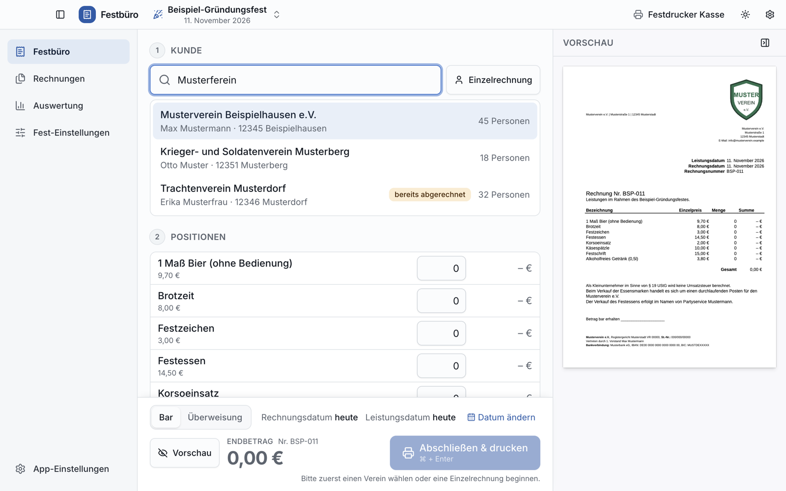

Festbüro vergibt dann die nächste Rechnungsnummer, legt das PDF im Dokumentenordner ab und druckt sofort.
Mit **Neue Rechnung** (Enter) geht es direkt mit dem nächsten Verein weiter.

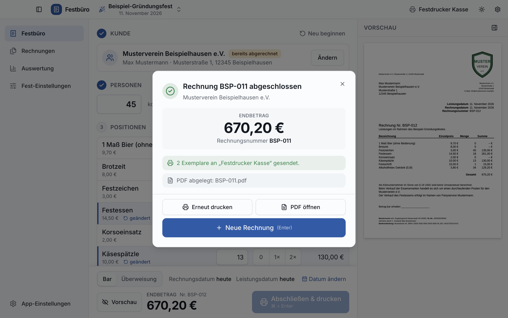

### Fehler korrigieren (Storno)

Eine abgeschlossene Rechnung kann nicht mehr geändert oder gelöscht werden – so bleibt die Buchhaltung sauber.
Stattdessen wird sie **storniert**: Unter **Rechnungen** die Rechnung auswählen, **Stornieren** wählen und einen
Grund angeben. Es entsteht ein Stornobeleg mit eigener Nummer. Mit **Stornieren und neu erstellen** öffnet
sich die Maske gleich mit den alten Angaben, sodass nur noch die Korrektur nötig ist.

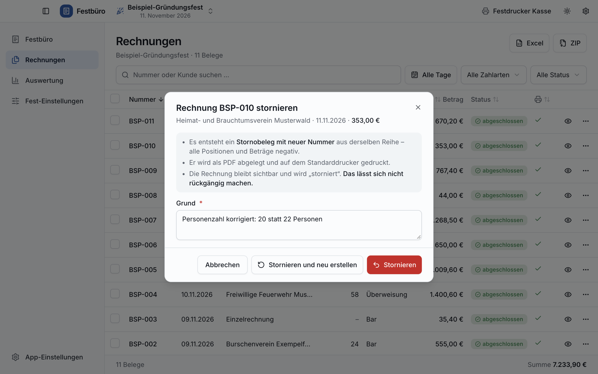

### Alle Rechnungen im Blick

Unter **Rechnungen** stehen alle Belege des Fests: Suche nach Nummer oder Kunde, Filter nach Zeitraum, Zahlart
und Status, die Summe unten rechts. Ein Klick auf die Nummer zeigt die Rechnung genau so, wie sie gedruckt
wurde. Von hier lässt sich eine Rechnung **erneut drucken** oder als PDF speichern.

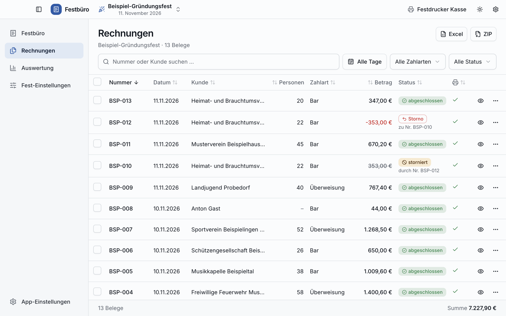

### Praktische Tastenkürzel

Auf dem Mac ⌘, unter Windows Strg. Alle Kürzel zeigt ⌘/Strg + / an.

| Kürzel | Funktion |
| --- | --- |
| ⌘/Strg + N | Neue Rechnung |
| ⌘/Strg + Umschalt + N | Neue Einzelrechnung |
| ⌘/Strg + Enter | Abschließen & drucken |
| ⌘/Strg + P | Letzte Rechnung erneut drucken |
| ⌘/Strg + F | Suchen |
| ⌘/Strg + 1 / 2 / 3 / 4 | Festbüro / Rechnungen / Auswertung / Fest-Einstellungen |

Festbüro funktioniert auch im halben Bildschirm. Ist das Fenster schmal, lässt sich die Vorschau einblenden;
der Endbetrag bleibt immer sichtbar. Unter **App-Einstellungen → Darstellung** gibt es einen Dunkelmodus.

## 4. Nach dem Fest

Die Seite **Auswertung** zeigt den Umsatz nach Stornos, aufgeteilt nach Bar und Überweisung, die abgerechneten
Personen, die Mengen pro Produkt, den Umsatz pro Tag, die Steuersätze und die **Vereine ohne Rechnung**.

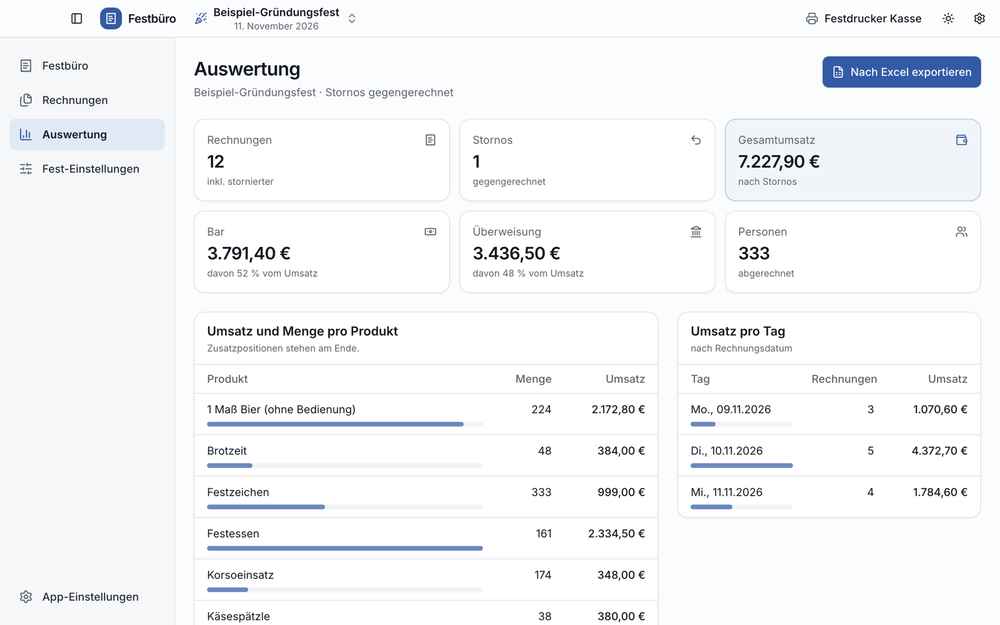

Über das Menü **Ablage** (Mac) bzw. **Datei** (Windows) lassen sich exportieren:

- die Auswertung als Excel-Datei,
- die Rechnungsliste als Excel-Datei,
- alle Rechnungs-PDFs gesammelt als ZIP-Datei.

Die PDFs liegen außerdem im Dokumentenordner unter `<Festname>/Rechnungen` (Stornos unter
`<Festname>/Stornos`).

**Mehrere Feste:** Oben in der Kopfleiste lässt sich das aktive Gründungsfest wechseln oder über
**Neues Fest anlegen …** ein weiteres anlegen. Jedes Fest hat eigene Produkte, Vereine, Vorlage und
Rechnungsnummern.

## 5. Datensicherung

**Sichern:** **App-Einstellungen → Datensicherung erstellen** (oder Menü Ablage/Datei → Datensicherung
erstellen …). Festbüro legt eine ZIP-Datei im Dokumentenordner unter `Datensicherungen` an. Sie enthält alle
Daten und Logos; ältere Sicherungen werden nie überschrieben. Am besten nach jedem Festtag sichern und den
ganzen Dokumentenordner zusätzlich auf einen USB-Stick kopieren.

**Wiederherstellen:**

1. Festbüro beenden.
2. Den Datenordner öffnen (**App-Einstellungen → Info → Datenordner „Öffnen“**):
   - Mac: `~/Library/Application Support/Festbüro`
   - Windows: `%APPDATA%\Festbüro`
3. Die vorhandenen Dateien `festbuero.sqlite`, `festbuero.sqlite-wal`, `festbuero.sqlite-shm` und den Ordner
   `logos` zur Sicherheit an einen anderen Ort verschieben.
4. `festbuero.sqlite` und den Ordner `logos` aus der ZIP-Datei in den Datenordner kopieren.
5. Festbüro starten. Eine Sicherung aus einer älteren Version wird automatisch übernommen; eine Sicherung
   aus einer neueren Version lässt sich erst nach einem Update öffnen.

## Häufige Fragen

**Braucht Festbüro Internet?**
Nein. Alles läuft und speichert lokal auf dem Rechner.

**Wo finde ich die PDFs?**
Im Dokumentenordner, den man bei der Einrichtung gewählt hat (änderbar unter App-Einstellungen).
Nach dem Abschließen öffnet ⌘/Strg + Umschalt + O das PDF der letzten Rechnung.

**Der Drucker druckt nicht – was tun?**
In der Kopfleiste bzw. unter App-Einstellungen prüfen, ob der richtige Festdrucker gewählt und als verfügbar
angezeigt ist, und eine Testseite drucken. Das PDF ist auf jeden Fall gespeichert und kann unter
**Rechnungen** jederzeit erneut gedruckt werden.

**Kann ich eine Rechnung nachträglich ändern?**
Nein, nur stornieren und neu erstellen – siehe [Fehler korrigieren](#fehler-korrigieren-storno).

---

Für Entwicklerinnen und Entwickler: [`docs/development.md`](docs/development.md)
(Bauen, Tests, Veröffentlichen, Code-Signierung).

**Lizenzhinweis:** Der Windows-Installer enthält **SumatraPDF** als eigenständiges, unverändertes Programm
für den stillen PDF-Druck (GNU GPL v3 bzw. AGPL v3, einzelne Teile BSD). Version, Herkunft, Prüfsummen,
Lizenztexte und Link zum Quellcode: [`resources/win/README.md`](resources/win/README.md). Die übrigen
Open-Source-Pakete stehen unter ihren jeweiligen Lizenzen (siehe `package-lock.json`).
